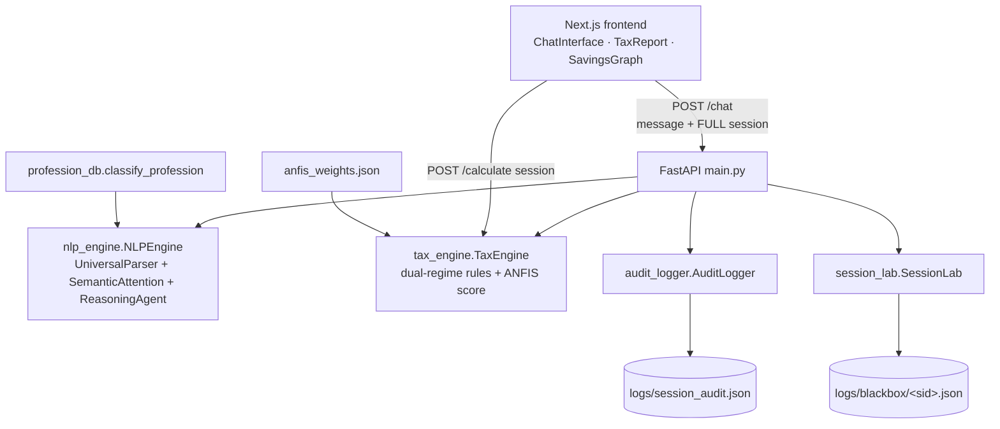

# Architecture — Tax Assist AI

> Audience: engineers joining the project. Written 2026-10-31 from a full-codebase audit.
> Related: [tax-rules.md](tax-rules.md) · [decisions.md](decisions.md) · [deployment.md](deployment.md) · [roadmap.md](roadmap.md)

## 1. System overview

Two-tier architecture: a **Next.js 16 / React 19** single-page frontend and a **Python 3.10+ / FastAPI** backend that holds all intelligence. There is **no database** — persistence is JSON files on disk, and all conversation state lives in the client and is round-tripped on every request.



## 2. Component inventory

| Component | File | Responsibility |
|---|---|---|
| API layer | `backend/main.py` | 3 endpoints: `POST /chat`, `GET /history/{sid}`, `POST /calculate`; CORS; background audit |
| NLP engine | `backend/nlp_engine.py` | Multi-turn flow (Profiling → Income → Expenditure → Final); entity extraction; zero-sentinel; corrections |
| Money parser | `backend/ai_models.py` → `UniversalParser` | Indian numbering: digits, lakh/crore/k/LPA, word forms ("thirty five lakhs"), `pm` annualization |
| Semantic attention | `backend/ai_models.py` → `SemanticAttention` | Keyword + Gaussian-proximity scoring maps each number to a category; profile-locked penalties |
| Reasoning agent | `backend/ai_models.py` → `ReasoningAgent` | Discovery waterfall — picks the next question; generates savings tips |
| Profession classifier | `backend/profession_db.py` | 676 root strings (462 salaried / 214 business) + `difflib` fuzzy match → `Salaried` / `Business Owner` |
| Tax engine | `backend/tax_engine.py` | Old & New regime computation, deduction caps, 87A rebate, surcharge, capital gains, risk observations |
| ANFIS scorer | `backend/ai_models.py` → `ANFIS` + `backend/anfis_weights.json` (95 KB) | Neuro-fuzzy "efficiency score" 0–100 (20 inputs × 64 rules, TSK) |
| Trainer | `backend/anfis_trainer.py` | Generates synthetic scenarios (200k, not the 1M the README claims) and fits weights via EE-Bat search |
| Audit logger | `backend/audit_logger.py` | Appends every turn to `logs/session_audit.json` |
| Black box | `backend/session_lab.py` | Per-session turn log at `logs/blackbox/<sid>.json` |
| Chat UI | `frontend/src/components/ChatInterface.tsx` | Chat loop, phase stepper, quick suggestions, debug panel |
| Report UI | `frontend/src/components/TaxReport.tsx` | KPI tiles, ITR-style computation table, slab breakdown, CA-advice tabs |
| Comparison UI | `frontend/src/components/SavingsGraph.tsx` | Old-vs-New regime bars + savings banner |

## 3. Request lifecycle

### `POST /chat` (`backend/main.py:41`)
1. Client sends `{message, session}` — **the session is the entire conversation state, stored in the browser** (`ChatInterface.tsx:148-152`) and sent back on every turn.
2. `nlp.process_message()` mutates the session dict in place: profile detection, contextual flags (`has_parents`, `has_home_loan`, `pays_rent`), per-sentence entity extraction, zero-sentinel handling, corrections, phase update (`backend/nlp_engine.py:68-220`).
3. If any income key > 0 → `engine.calculate_tax_advanced(session)` runs and the result is attached as `tax_report` (`main.py:48-59`).
4. Audit logging is scheduled via `BackgroundTasks` so the response can return first, but the **black-box log write is synchronous** inside the handler — only `audit.log_interaction` is deferred (`main.py:58-76`).
5. Response: `{response, session, extracted, plan, tax_report}` — the client **replaces its session wholesale** with `data.session`.

### `POST /calculate` (`backend/main.py:95-99`)
Unvalidated `Dict[str, Any]` → tax engine → full dual-regime report. `TaxReport.tsx:17-45` calls this on **every session object change**, duplicating the calculation `/chat` already performed.

### `GET /history/{sid}` (`backend/main.py:82-91`)
Reads the **entire** `logs/session_audit.json` synchronously inside an async handler, filters by `session_id`. No authentication; session IDs are timestamp-based and guessable.

## 4. Session state model (client-owned)

The session dict is the single source of truth and is fully client-controlled. Keys used by the code:

| Group | Keys |
|---|---|
| Income | `salary`, `business`, `rental`, `other_income`, `agriculture`, `capital_gains[]` (`{type, amount, holding}`) |
| Deductions | `80c`, `80d`, `80d_parents`, `80e`, `80g`, `80eea`, `nps`, `80tta`, `80ttb`, `80gg`, `80u_80dd`, `80ddb`, `24b`, `hra`, `professional_tax` |
| Profile / flow | `id`, `profile`, `phase`, `has_parents`, `has_home_loan`, `pays_rent`, `_last_question`, `_last_val`, `_prev_salary`, `history[]` |

Consequences (see [decisions.md](decisions.md) ADR-002): state is tamperable, payloads grow with `history`, internal keys (`_last_val`) are forgeable, and there is no server-side session or multi-device support.

Note: the frontend stepper advertises 5 phases (`PROFILING, INCOME, EXPENDITURE, RECALL, FINAL`, `ChatInterface.tsx:15`), but the backend only ever sets `PROFILING` / `INCOME` / `EXPENDITURE` / `FINAL` (`nlp_engine.py:221-231`) — `RECALL` is never produced.

## 5. Known architectural weaknesses (audit 2026-10-31)

| # | Weakness | Evidence |
|---|---|---|
| W1 | Client-owned session state | `main.py:29-32`, `ChatInterface.tsx:148-152` |
| W2 | File-as-database audit log: full read-modify-write per request, no locking, silently truncated on read error | `audit_logger.py:24-35` |
| W3 | Dead/broken duplicate modules: `nlp_engine_v2.py` imports nonexistent classes; `anfis_refine.py` expects 10×50 weights vs trainer's 20×64 | `nlp_engine_v2.py:5`, `anfis_refine.py:15` |
| W4 | ANFIS training ground-truth diverges from the live engine (different HRA/surcharge math) | `anfis_trainer.py` vs `tax_engine.py:316-321,283-292` |
| W5 | No request schema validation on the API boundary | `main.py:95-99` |
| W6 | Backend URL hardcoded in the frontend | `ChatInterface.tsx:148`, `TaxReport.tsx:24` |
| W7 | ANFIS weights reshaped without validation at import — mismatched file crashes startup | `ai_models.py:482-485` |

Remediation sequencing lives in [roadmap.md](roadmap.md); decision records in [decisions.md](decisions.md).

## 6. Tech stack

| Layer | Technology | Notes |
|---|---|---|
| Frontend | Next.js 16.2.4, React 19.2.4, TypeScript 5 (strict) | Vanilla CSS, no UI kit; `any`-typed props |
| Backend | FastAPI, Pydantic (request model for `/chat` only), Uvicorn | Runs on `0.0.0.0:8000` |
| ML | NumPy (ANFIS inference) | `scikit-learn`, `pandas` declared in `requirements.txt` but unused by runtime code |
| Persistence | JSON files (`logs/`) | No DB, no locking, no rotation |
| Tests | Custom harness (`backend/test_suite.py`) | No pytest, no CI, no frontend tests |

## 7. Repository layout

```text
Tax_Assist-system-main/
├── AGENTS.md, README.md, research_report.md
├── backend/
│   ├── main.py               # FastAPI entry
│   ├── tax_engine.py         # calculation core
│   ├── nlp_engine.py         # conversational engine (v2 is dead code)
│   ├── ai_models.py          # parser, attention, agent, ANFIS
│   ├── profession_db.py      # profession taxonomy
│   ├── audit_logger.py       # session_audit.json
│   ├── session_lab.py        # logs/blackbox/<sid>.json
│   ├── anfis_trainer.py      # offline training (writes anfis_weights.json)
│   ├── anfis_weights.json    # committed model weights
│   ├── test_suite.py         # 97-check custom harness (+ smoke/final/stress scripts)
│   └── logs/                 # runtime artifacts (gitignored, PII in working tree)
├── frontend/
│   └── src/
│       ├── app/              # layout.tsx, page.tsx, globals.css
│       └── components/       # ChatInterface, TaxReport, SavingsGraph
└── docs/                     # this documentation set
```

## 8. Scaling considerations

- **Single-process assumptions**: the audit log's read-modify-write pattern (`audit_logger.py:24-35`) loses entries with >1 worker; scale-out requires SQLite/Redis before extra Uvicorn workers.
- **Stateless compute**: the tax engine itself is pure and thread-safe — it scales horizontally once state and logging move off disk.
- **Frontend**: static-exportable (no server components with data), trivially CDN-hostable once the API URL becomes configurable.
- The regex NLP layer is CPU-bound per message and message length is currently unbounded — cap input size before exposing publicly (see [security.md](security.md)).
