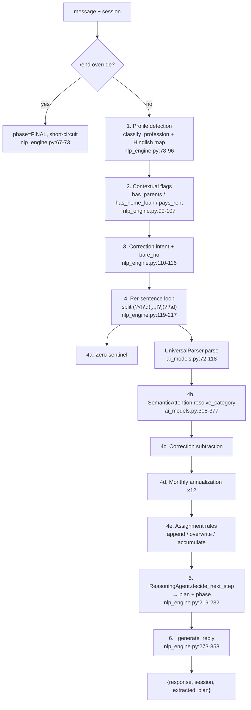

# NLP Pipeline — from message to session mutation

> Verified against the code 2026-10-31. Behavior examples marked "verified" were produced by executing the current engine (Python 3.15, `NLPEngine()` as constructed by `main.py`) on that date. Related: [api-reference.md](api-reference.md) (payload shapes) · [architecture.md](architecture.md) §4 (session keys) · [testing.md](testing.md) (coverage of this pipeline).

## 1. Overview

There is no ML model in the extraction path — three hand-built classes in `backend/ai_models.py` orchestrated by `backend/nlp_engine.py`, plus a keyword taxonomy in `backend/profession_db.py`:



The session dict is mutated **in place** and returned; the HTTP layer attaches `tax_report` when any income key is positive (`main.py:47-55`).

## 2. UniversalParser — number formats (`ai_models.py:25-118`)

Two regex passes over each sentence; results are `{val, start, end}` spans used later for proximity scoring.

| Format | Example | Result | Mechanism |
|---|---|---|---|
| Indian-format digits | `1,50,000` | 150000 | `digit_pat` strips commas (`ai_models.py:45-49,77-81`) |
| Lakh family | `2.5 lakh`, `12.5L`, `36 lpa`, `2 lacs` | ×1e5 | `unit_map` (`ai_models.py:38`) — `l` is matched with a negative lookahead `l(?!e)` to avoid "lecture" |
| Thousands | `10k`, `30 thousand` | ×1e3 | `unit_map` (`ai_models.py:39`) |
| Crore / million | `1.5 crore`, `3cr`, `2 mn` | ×1e7 / ×1e6 | `unit_map` (`ai_models.py:40-41`) |
| Per-month unit | `45k pm`, `50,000 per month` | ×12 | unit ×12 in pass 1 (`ai_models.py:85`) **and** a 14-char trailing-window check for `pm` / `per month` / `/month` / `p.m` (`ai_models.py:88-90`) |
| English word forms | `thirty five lakhs`, `two crore`, `five thousand` | ×unit | `word_pat` + `_resolve_words` (`ai_models.py:51-56,58-70`); `hundred` multiplies the running total |
| Hinglish words | `do lakh`, `das thousand` | ×unit | `word_map` includes `ek`…`das` (`ai_models.py:34-35`) |

Guards: digit results below 100 are dropped (`ai_models.py:92-93`); word results below 1,000 are dropped (`ai_models.py:114-115`); word matches overlapping an already-claimed digit span are skipped (`ai_models.py:101-103`). Known trap: **"per month" is annualized here and again by the NLP engine (§6)** — `"my salary is 80,000 per month"` produces `salary = 11,520,000` through the full flow (verified; tracked as C3 in [tax-rules.md](tax-rules.md) §4).

## 3. SemanticAttention — category scoring (`ai_models.py:124-377`)

20 categories (`salary`, `business`, `rental`, `agriculture`, `capital_gains`, `other_income`, `80c`, `80d`, `80d_parents`, `80e`, `80g`, `nps`, `hra`, `24b`, `80eea`, `80tta`, `80ttb`, `80gg`, `80u_80dd`, `80ddb`) each with positive-keyword lists — **340 positive keywords** in total (`ai_models.py:127-306`) — and short negative-keyword lists. For a sentence `t`, a value span `[val_start, val_end]`, and every keyword occurrence:

```text
neg_penalty      = -10.0  if any negative keyword of that category appears ANYWHERE in t, else 1.0
dist             = min(|kw_start − val_start|, |kw_start − val_end|)
prox_score       = 100 · exp(−dist² / (2 · 40²))          # Gaussian, σ = 40 chars
content_score    = 2.5 · (#words in kw) + 0.1 · (#chars in kw)
profile locks    = prox_score × 0.1  if profile == "Business Owner" and cat == "salary"
                   prox_score × 0.1  if profile == "Salaried" and cat == "business"
match_score      = prox_score · content_score · neg_penalty     # ai_models.py:331-344
```

Then (`ai_models.py:348-377`):

1. **Subsumption** — a match inside a longer matched keyword is dropped (longest phrase wins).
2. **Aggregate** — category score = sum of its match scores.
3. **Contextual prior** — the category the last question was about (`asked_cat`, see §7) gets `+30` if the current best score is below 150 (`ai_models.py:369-372`).
4. **Default** — if no category scored ≥ 10, return the profile default: `business` for Business Owner, `salary` for Salaried, otherwise `other_income` (`ai_models.py:311,374-375`).
5. Otherwise `argmax`.

Behavioral consequences worth knowing when extending the keyword tables:

- The σ = 40 proximity decay is **gentle** — a keyword 30 characters away still contributes ~75% of its score, so in a multi-topic sentence a long keyword far from the number can beat a short keyword next to it (content_score is the differentiator).
- The **negative-keyword penalty is sentence-global**, not number-local: `"I invested 1.5L in PPF and 50k in health insurance"` contains `health`, which zeroes out the entire `80c` category (its `neg` list contains `"health"`, `ai_models.py:218`) and hands **both** numbers to `80d`. Verified — this is the mechanism behind the PPF→80D pattern in §9.
- Profile locks are ×0.1, not hard blocks — a strong keyword can still cross the lock.
- `asked_cat` prior applies per number, so an answer to a targeted question is usually classified correctly even with weak keywords.

## 4. Zero-sentinel (`nlp_engine.py:45-59,128-135,275-290`)

- `_is_zero_intent` matches standalone negation words (`no`, `nope`, `nahi`, `nil`, `zero`, `skip`, `n/a`, …) and negative phrases (`don't have`, `no investment`, `kuch nahi`, …).
- **Per sentence**: if the sentence is zero-intent and the category currently being asked about (`asked_cat`) is still `None`, it is set to `0` and `"80C: Noted (None)"`-style badge is emitted (`nlp_engine.py:128-135`).
- **Bare "no"** (zero-intent message with no digits, `nlp_engine.py:116`): if any income exists, the reply generator fills the first `None` slot of `["80c","80d","nps","hra","24b","80g"]` with `0` and re-renders the next question — this is what lets a user skip through the waterfall with "no" (`nlp_engine.py:275-287`). Quirk: the `plan` field returned by `process_message` is computed **before** this fill, so on bare-no turns `plan` lags the actual `response` (verified).

## 5. Corrections (`nlp_engine.py:110-116,140-177`)

1. **Correction intent** is detected by keywords: `meant`, `correction`, `actually`, `wrong`, `not that`, `revise`, `instead of`, `change`, `galat`, … (`nlp_engine.py:110-114`).
2. **Numberless correction** (`"no that was 80C"`): the sentence is scanned against the attention categories' first six positive keywords to find the target category; if `_prev_salary` exists (the previous salary was displaced), it is restored; then `_last_val` (the most recently parsed number) is re-booked into the target category with a `(CORRECTED)` badge (`nlp_engine.py:141-154`).
3. **Numeric correction** (correction phrase + a number): the value is **subtracted** from the first suspect category (`salary`, `business`, `nps`, `80c`, `80g`, `hra`, `other_income`) whose current value is ≥ the correction amount, floor 0, then the new value is booked normally (`nlp_engine.py:167-177`).

Verified round-trip: `"I am a pilot earning 60 lakhs"` → `"2 lakhs"` (overwrote salary to 200,000) → `"no that was 80C"` restores `salary = 6,000,000` and sets `80c = 200,000`.

## 6. Monthly annualization (`nlp_engine.py:179-185`)

If the sentence contains any of `monthly`, `per month`, `p.m`, `/month`, `every month`, `har mahine`, `mahine ka`, `" pm "`, the parsed value is multiplied by 12 and the badge gains `(ANNUALIZED)`. **This stacks with the parser's own pm handling (§2)** — the double conversion is finding C3 in [tax-rules.md](tax-rules.md); a fix is roadmap Week 1 item 1.

## 7. Assignment rules (`nlp_engine.py:188-217`)

| Case | Rule |
|---|---|
| `capital_gains` | Appends `{type, amount, holding: "unknown"}`; type inferred from message text — `equity_stcg` if `short`/`stcg`/`less than 1` present, else `equity_ltcg` when share/MF words present, else `property_cg` (`nlp_engine.py:190-202`) |
| `salary`, `business`, `rental`, `other_income`, `age` (`OVERWRITE_CATS`) | **Overwrites** the key. A second same-category number in the *same turn* accumulates instead. A changed salary parks the old value in `_prev_salary` so corrections can restore it (`nlp_engine.py:203-210`) — this is also how junk numbers (§9 tuition→salary) **destroy** a previously entered salary |
| Everything else (`80c`, `80d`, `nps`, …) | Accumulates onto the existing value (`nlp_engine.py:211-215`) |

## 8. Discovery waterfall & phases

`ReasoningAgent.DISCOVERY_STEPS` (`ai_models.py:384-392`) fixes the interview order: `income → 80c → 80d → nps → hra → 24b → 80g`. `decide_next_step` (`ai_models.py:394-416`) asks for income while total income is 0, then returns the description of the first slot whose key is `None`, skipping `24b` unless `has_home_loan` and `hra` for Business Owners, and finally `"plan: Final audit ready."`.

The phase machine maps the plan text to `PROFILING / INCOME / EXPENDITURE / FINAL` (`nlp_engine.py:223-232`); `RECALL` exists in the frontend stepper (`ChatInterface.tsx:18`) but is never produced — see [architecture.md](architecture.md) §4. The reply generator (`nlp_engine.py:273-358`) renders a canned question per plan branch, prepends the grouped extraction summary (`_group_found`, `nlp_engine.py:249-267`), and on `"Final audit ready"` appends the first savings tip. Tips come from `get_savings_tips` (`ai_models.py:418-454`): 80C headroom vs ₹1.5L, NPS vs ₹50k, missing 80D / parents' cover / 24(b) — amounts quoted are the engine's own constants.

`asked_cat` for the contextual prior is recovered from the last reply text (`_get_asked_cat`, `nlp_engine.py:25-43`): questions mentioning salary/income → `salary` (or `business` for Business Owners), and keyword probes for 80c / 80d / nps / 24b / hra / 80g.

## 9. Worked multi-turn example (verified)

Input sequence and the engine's actual output, with the mechanism annotated:

| # | User message | `extracted` | Mechanism |
|---|---|---|---|
| 1 | `I am a software engineer earning 18 LPA` | `SALARY: ₹1,800,000` | `classify_profession` → `Salaried` (substring `"engineer"`, `profession_db.py:297`); `lpa` ×1e5; `"salary"` keyword beats `"engineer"`-adjacent noise → `salary` ∈ OVERWRITE_CATS |
| 2 | `no` | *(none)* | bare-no → `80c` filled with `0`; response asks 80D, but returned `plan` still says 80C (§4 quirk) |
| 3 | `1.5 lakhs in PPF` | `80C: ₹150,000` | `"ppf"` keyword (dist ≈ 2 → prox ≈ 99.9 × content 3.1); asked_cat = 80d gets +30 prior but has no keyword in the sentence |
| 4 | `no` | *(none)* | bare-no → `80d = 0` |
| 5 | `25k health insurance` | `80D: ₹25,000` | `"health insurance"` content 6.5 + prior; no competing keyword |
| 6 | `no`, `no` | *(none)* | `nps = 0`, `hra = 0` |
| 7 | `/end` | *(none)* | override → `phase = FINAL`, plan `"Final audit ready."` |

Final session: `{profile: "Salaried", salary: 1800000, 80c: 150000, 80d: 25000, nps: 0, hra: 0, 24b: 0, phase: "FINAL"}`. Each turn after #1 also carries a populated `tax_report` (see [api-reference.md](api-reference.md) for that exact object).

## 10. Profession classification (`profession_db.py`)

- **Taxonomy**: 676 root strings — 462 `SALARIED_ROOTS` (`profession_db.py:17-179`), 214 `BUSINESS_ROOTS` (`profession_db.py:181-271`). (The module docstring's "~20,000+ professions" claim refers to compound coverage of roots, not literal entries.)
- **Classification order** (`classify_profession`, `profession_db.py:280-326`):
  1. Ownership signals (`own `, `my shop`, `run a`, `self employ`, `proprietor`, …) → Business Owner, **unless** the text also contains `job` / `salaried` / `employee` (`profession_db.py:288-294`).
  2. Exact substring over **SALARIED roots first, then BUSINESS roots** — order matters on overlap (`profession_db.py:296-302`).
  3. Per-word fuzzy match, words ≥ 4 chars, `difflib.get_close_matches` cutoff **0.82**, again salaried-first (`profession_db.py:304-314`).
  4. Bigram fuzzy match, cutoff **0.80** (`profession_db.py:316-324`).
  5. `None` → the NLP engine then tries the Hinglish map (`naukri`, `dukaan`, `vyapar`, …, `nlp_engine.py:78-87`) and leaves the profile unset if nothing matches.
- Fallback for unclassified profiles: SemanticAttention's default category becomes `other_income` (§3), which is how unmapped income utterances end up there.

## 11. Known misclassification patterns

The repo's own logs (`backend/logs/session_audit.json`, 221 entries recorded 2026-04-22/23) show systematic errors in production conversations. For each headline pattern, **current-code behavior was re-verified by executing the engine on 2026-10-31** — two of the four have since been fixed by keyword additions; two still reproduce.

| Pattern | Log evidence | Current behavior (verified 2026-10-31) | Mechanism / status |
|---|---|---|---|
| **Tuition → salary** | Entry idx 200-201, `sid_1776965272179`, 2026-04-23 22:58-22:59: `"childs tution of 2 Lakhs"` mapped `SALARY: ₹200,000`, **overwriting** a salary of 5,600,000 | **Still reproduces**: `"childs tution of 2 Lakhs"` → `SALARY: ₹200,000`, salary replaced | The 80C keyword list only has `tuition fee(s)`/`tution fee(s)`/`child tuition`/`school fees` — bare `"tution"` without `fee` matches nothing, so the score threshold (< 10) falls through to the profile default `salary`, and the OVERWRITE rule destroys the prior value (`nlp_engine.py:203-210`). Open. |
| **PPF → 80D** | Entry idx 66, `sid_1776883718048`, 2026-04-23 00:25: `"I invested 1.5L in PPF and 50k in health insurance"` mapped `80D: ₹150,000` + `80D: ₹50,000` | **Still reproduces** (both amounts → 80D) | Sentence-global negative-keyword penalty: `health` is in `80c.neg` (`ai_models.py:218`) → the whole 80C category scores −10 ×, while `80d` gets the long-keyword content score plus the +30 asked-category prior. Open. |
| **Property sale → income (not capital gains)** | Entry idx 15, `test_1776875973906`, 2026-04-22 22:10: `"i earned 30 lakhs from salary, 14 lakhs from property sale and 5 lakhs from rental"` produced `other_income: 4,900,000` (all three numbers) | Reproduces in mutated form: salary → 3,000,000 correctly, but `"14 lakhs from property sale"` → **RENTAL** 1,400,000 | `"property sale"` is not in `capital_gains.pos` (that list has `property sold`, `house sale`, `land sale`, but not the noun phrase used here, `ai_models.py:179-193`), so the trailing `"rental"` keyword captures the whole sentence. Open. |
| **Education-loan interest → income** | Entry idx 31, `test_1776876480615`, 2026-04-22 22:19: `"yes 5 lakhs from education Loan"` grew `other_income` to 5,700,000 | **Fixed in current code**: maps to `80E: ₹500,000` because `"education loan"` was added to `80e.pos` (`ai_models.py:241-246`) | Historical; note the *amount* semantics remain crude (loan amount booked as an interest deduction). |
| Corporate mega-prompt | Entry idx 109/120/121, 2026-04-23 21:04-21:31: the 90-word `industrial_stress_test.py` prompt mapped business profit (15L), monthly rent (1.2L), health-insurance premiums (25k + 50k) all to `SALARY` (total 10,195,000) | Same root cause as tuition→salary: unmatched categories fall through to the profile default and overwrite `salary` | Salaried default + OVERWRITE_CATS. Open. |
| Freelance → Salaried | Not in logs; found by probe | `"freelance designer"` → `Salaried` | Word-loop checks salaried fuzzy matches first: `"designer"` ≈ `"ux designer"` (0.84 ≥ 0.82) before `"freelance"` ≈ `"freelancer"` is ever consulted (`profession_db.py:309-311`). Open. |
| "business owner and teacher" → Salaried | Entry idx 109: `"I am a business owner and teacher"` set `profile: "Salaried"` | Still reproduces | Exact-substring pass hits salaried root `"teacher"` before business root `"business owner"`; the ownership-signal guard (§10 step 1) only checks phrases like `own `/`my shop`, not the literal phrase `business owner`. Open. |
| Double annualization | Not in the April logs (engine predated it); verified in current code | `"my salary is 80,000 per month"` → `salary = 11,520,000` | Parser ×12 (`ai_models.py:85,88-90`) + engine ×12 (`nlp_engine.py:179-185`). Tracked as C3 in [tax-rules.md](tax-rules.md); fix is roadmap Week 1 item 1. |

Regression protection for these patterns is the golden-file test target in ADR-011 ([decisions.md](decisions.md)) and [testing.md](testing.md) §4; the extraction-time countermeasures live in roadmap Week 1 item 8.

## 12. What the NLP layer never does

- It never talks to a model, API, or dictionary service — everything is regex + keyword tables (ADR-003 in [decisions.md](decisions.md)).
- It never validates amounts against caps — caps are applied later by the tax engine (see [tax-rules.md](tax-rules.md) §2); the session may hold `80c: 10,000,000` and the engine silently clamps it.
- It never writes to disk — persistence happens in the API layer ([architecture.md](architecture.md) §3, [security.md](security.md)).
