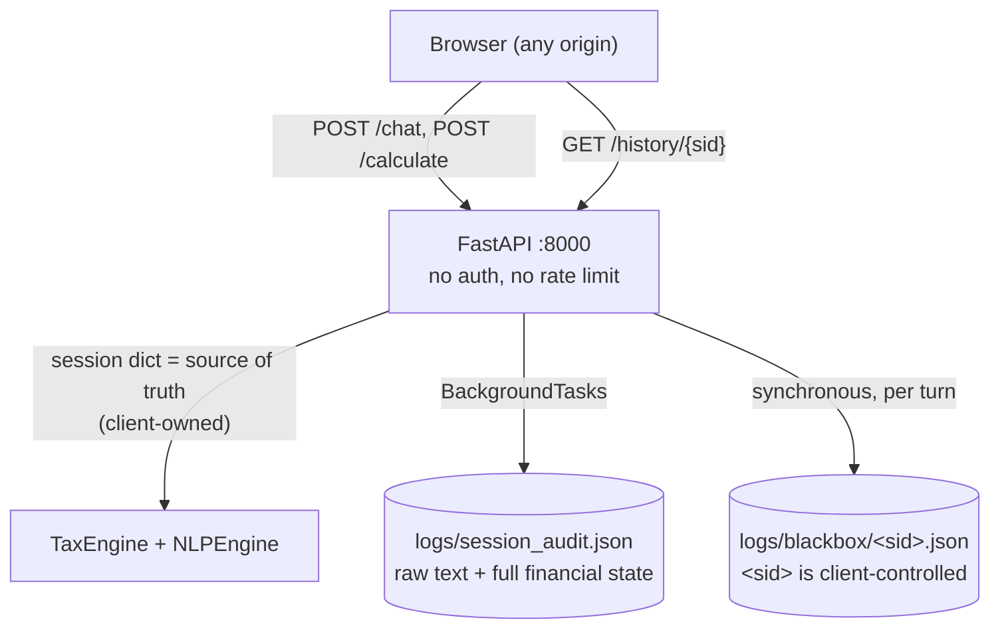

# Security — threat model and hardening checklist

> Factual, defensive documentation grounded in the code as of 2026-10-31. No exploit techniques or payloads are described; each finding cites the code that needs to change. Remediation is sequenced in [roadmap.md](roadmap.md); decision records in [decisions.md](decisions.md). This file expands the checklist in [deployment.md](deployment.md) §4.

## 1. Trust model today

Three structural facts drive every finding below:

1. **There is no authentication, authorization, or rate limiting anywhere** — the FastAPI app defines no security middleware or dependency (`main.py:14-98`).
2. **The session is client-owned** (ADR-002): the server's only state is what the request body carries (`main.py:29-31`), so every "server-side" decision actually runs on attacker-editable input.
3. **CORS is `allow_origins=["*"]`** with all methods and headers (`main.py:16-22`), so any website can call and read this API from a visitor's browser (no credentials are needed — `allow_credentials=False`).

## 2. Findings

Ordered by severity. IDs reuse the audit numbering used in [roadmap.md](roadmap.md) and [decisions.md](decisions.md).

### C6 — Client-controlled `session.id` used in a filesystem path (Critical)

`SessionLab.record_turn` builds the log path directly from the session ID supplied in the request body:

- `main.py:58` takes `sid` from `request.session.get("id", "default")`; `main.py:69` passes it to `lab.record_turn(...)`.
- `session_lab.py:22` computes `file_path = os.path.join(self.lab_dir, f"{session_id}.json")` with **no sanitization** — no character allowlist, no basename check. Values containing path separators or absolute paths are not rejected, so the write location is attacker-influenced (arbitrary file write with a `.json` suffix).
- The written content is a full JSON state snapshot (`session_lab.py:31-47`), and the file is also **read back** if it exists (`session_lab.py:26-28`).

Impact: remote code-influence on the server filesystem (overwrite/plant JSON data, degrade other files' integrity) for anyone who can reach port 8000. Fix is roadmap Week 1 item 4 / ADR-009: enforce `^[\w-]{8,64}$` (or generate IDs server-side, ADR-007) before the value touches the filesystem.

### C5 — No authentication + guessable session IDs on `GET /history/{sid}` (Critical)

- `main.py:81-92` returns any session's audit entries to any caller; there is no 401/403 path.
- Session IDs are client-generated timestamps: `sid_${Date.now()}` (`ChatInterface.tsx:105`), making the space enumerable in principle.
- The response contains the full financial picture: raw user text plus `internal_state` with every income and deduction figure (`audit_logger.py:16-34`; response shape in [api-reference.md](api-reference.md)).

Impact: cross-session financial-data disclosure. Fix: roadmap Week 3 item 1 — server-issued opaque IDs (ADR-007) plus request authentication; until then the endpoint must not be exposed.

### H5 — Unvalidated `/calculate` (and NLP) input (High)

- `/calculate` accepts raw `Dict[str, Any]` (`main.py:94-98`); `/chat` validates only that `message` is a `str` and `session` a dict (`main.py:29-31`).
- Amounts are coerced with `float(x or 0)` (`tax_engine.py:53-87`): `null`/missing keys are tolerated, but non-numeric strings raise `ValueError` → unhandled `500`.
- `capital_gains` entries are assumed to be objects with `get`/`amount` (`tax_engine.py:58-60,296-299`) — malformed entries raise `AttributeError` → `500`. Only the outer key is type-checked (a non-list `capital_gains` is discarded).
- There is **no size or magnitude bound**: message length, array lengths, and numeric magnitude are unbounded; the NLP layer is CPU-bound per message (regex + a 340-keyword scan across all occurrences, [nlp-pipeline.md](nlp-pipeline.md) §3), which makes cheap CPU-exhaustion requests possible.
- Any field can be forged: `age` drives senior-citizen branches (`tax_engine.py:62-64`), `phase`/`profile` drive flow, deduction keys are trusted as-is and only capped, never validated.

Impact: 500 noise (stack traces in server logs), easy resource exhaustion, and arbitrary computation on tampered inputs. Fix: Pydantic models with bounds + a global exception handler (roadmap Week 1 item 5).

### W1 — Client-owned session trust (High, architectural)

Because the server keeps nothing (ADR-002, `main.py:29-31`), all of the following are attacker-editable on every request: `salary`, every deduction, `capital_gains[]`, `age`, `profile`, `phase`, and internal keys (`_last_val`, `_prev_salary`, full `history`). Consequences: computation results are only as honest as the client; `history[]` grows payloads unboundedly; there is no way to authenticate a session (root cause of C5). Fix: ADR-007 (server-side state) or, minimally, signed sessions.

### S6 — Plaintext PII at rest (High, compliance)

- `logs/session_audit.json` stores raw `user_input`, the full AI reply, and the entire session state — income, deductions, family context — as plaintext JSON, rewritten on every turn (`audit_logger.py:14-45`). The working tree currently holds 221 such entries from April 2026 sessions.
- `logs/blackbox/<sid>.json` mirrors the same per session (`session_lab.py:31-47`).
- No retention policy, no rotation, no encryption, no redaction. `.gitignore` excludes `backend/logs/` (`.gitignore:22`), but the files exist locally and the pattern is "keep everything forever".

Impact: DPDP Act 2023 / data-protection exposure on any real deployment; also a source of realistic test fixtures that should not be committed. Fix: roadmap Week 2 items 4-5 (append-only store, PII minimization, retention).

### H6 — Audit-trail fragility and race (High, integrity)

- `AuditLogger` reads the whole file, appends, and rewrites it with no lock (`audit_logger.py:24-35`); concurrent requests can drop entries, and a read error silently resets history to `[]`, after which the rewrite **destroys the existing trail** (`audit_logger.py:26-30`). This violates the repo's own "always preserve audit logging" rule (`AGENTS.md:22`).
- `SessionLab` has the same read-modify-write pattern per session file (`session_lab.py:24-47`).

Fix: ADR-009 (append-only JSONL or SQLite WAL; never truncate on read error).

### M — Supply chain: unpinned dependencies

`backend/requirements.txt` lists seven unpinned packages (`fastapi`, `uvicorn[standard]`, `pydantic`, `python-multipart`, `numpy`, `scikit-learn`, `pandas`); two of them (`scikit-learn`, `pandas`) are unused by runtime code (verified in [architecture.md](architecture.md) §6). Frontend versions are pinned exact in `frontend/package.json:12-24`, but there is no `npm audit` / `pip-audit` gate. Fix: roadmap Week 1 item 6 (pin + freeze) and Week 3 item 4 (audit in CI).

### L — Information and config hygiene (Low/Medium)

- **Hardcoded backend URL**: `http://localhost:8000` in `ChatInterface.tsx:148` and `TaxReport.tsx:24` (plus error copy at `ChatInterface.tsx:183` and `TaxReport.tsx:81`) — not a vulnerability by itself, but it hard-codes the attack-surface location into the client and blocks deployment hygiene (ADR-010).
- **CORS wildcard**: `main.py:18` — flagged above, listed here because the fix is configuration, not code structure.
- **No TLS**: Uvicorn serves plain HTTP on `0.0.0.0:8000` (`main.py:100-101`); dev default binds all interfaces.
- **No `/health` or observability**: failures are visible only as console prints (`main.py:55`, `audit_logger.py:36`, `session_lab.py:50`).
- **Error masking**: `/history`'s broad `except` returns `[]` for corrupt files (`main.py:86-92`) — availability issue disguised as success.

## 3. Hardening checklist (priority order)

| # | Priority | Action | Closes | Tracked in |
|---|---|---|---|---|
| 1 | **P0** | Sanitize `session_id` at the API boundary: reject values not matching `^[\w-]{8,64}$`; never pass raw request data into a filesystem path (ideally stop using the value in paths entirely) | C6 | roadmap W1-4, ADR-009 |
| 2 | **P0** | Add Pydantic request models with bounds for `/chat` and `/calculate` (message ≤ 4k chars, amounts ≤ 1e11, typed `capital_gains[]`, age range 0-120) plus a global exception handler returning 422, never 500 | H5 | roadmap W1-5 |
| 3 | **P0** | CORS allowlist from an env var; remove `allow_origins=["*"]` outside local dev | — | roadmap W1-6 |
| 4 | **P1** | Never expose `/history` without auth; bind it to the authenticated caller; issue opaque server-side session IDs | C5 | roadmap W3-1, ADR-007 |
| 5 | **P1** | Move session state server-side (SQLite → Redis); client sends `{session_id, message}` only | W1, enables #4 | ADR-007 |
| 6 | **P1** | **LANDED (Sprint 2 Step F — ADR-009/H6 fix).** Audit persistence is append-only JSONL: global stream `logs/audit/session_audit.jsonl` + per-session `logs/blackbox/<safe_sid>.jsonl`; one `os.write` per line under a process-wide lock; never truncate on any read/write error; corrupt lines are skipped with a counted warning and the file is never modified by a reader. Rotation: `TAX_AUDIT_MAX_BYTES` (default 10,000,000) shifts `session_audit.jsonl.N` generations, keeping `TAX_AUDIT_MAX_FILES` (default 5); retention: `TAX_AUDIT_RETENTION_DAYS` (default 30) sweeps expired *rotated* generations only — the active file is never deleted; invalid env ints fall back to the documented defaults. PII minimization at write: raw `user_input`/`ai_response` and state keys `history`/`memory`/`_last_val`/`_prev_salary`/`_last_question` are dropped, replaced by a sha256[:16] + char-length correlation record; `TAX_AUDIT_STORE_TEXT` opts back in (default off, 512-char cap). `/history` (gate unchanged) serves only the global stream — never the blackbox — with a read-only fallback to legacy `logs/session_audit.json`. Offline migration runbook (committed, not yet run on the real logs): `backend/tests/tools/migrate_audit_to_jsonl.py` docstring. | H6, S6 (partial) | ADR-009 |
| 7 | **P1** | Rate limiting + request size cap (body and message length) — the NLP layer is CPU-bound per message | H5 (DoS) | roadmap Week 3 gating |
| 8 | **P2** | Stop logging raw transcripts/financial state; define retention + rotation; scrub `backend/logs/` from the working tree | S6 | roadmap W2-4/5 |
| 9 | **P2** | Pin `requirements.txt` (commit `pip freeze`); drop unused `scikit-learn`/`pandas`; add `pip-audit` + `npm audit` to CI | M | roadmap W1-6, W3-4 |
| 10 | **P2** | Terminate TLS at a reverse proxy; bind Uvicorn to `127.0.0.1` in dev; add `GET /health` | L | deployment.md §5 |
| 11 | **P3** | `NEXT_PUBLIC_API_URL` for the frontend; remove hardcoded URLs and error copy that discloses the backend location | L | ADR-010 |
| 12 | **P3** | Security tests in CI: forged-session requests, malformed payloads, oversize inputs (part of the pytest migration) | regression guard | ADR-011 |

**Interim rule until items 1-7 land:** this backend must only ever listen on localhost and must not be port-forwarded, tunneled, or container-published to any shared network. The gating rule in [roadmap.md](roadmap.md) (Week 1 before any external user; Week 3 before public exposure) encodes this.

## 4. What is *not* currently a risk worth engineering

- `allow_credentials=False` with the wildcard CORS means no cookie/credential forwarding exists to abuse; the wildcard is still removed in item 3 because the API needs no credentials at all to read data (finding C5).
- The tax engine itself is pure computation with no `eval`/`exec`, no SQL, and no subprocess — findings here are about the boundary (paths, input trust, logging), not the math.
- Frontend stores state only in React memory (`ChatInterface.tsx:104-109`) — nothing sensitive is persisted in `localStorage`.

## 5. Observability posture (Sprint 3 Wave H, 2026-11-01)

Structured logging has landed and closes the "failures are visible only as console prints" gap from §1/L: every response carries a server-issued `X-Request-ID` (inbound values are never trusted), and every log record — ours, the audit module's failure logs, and the access records — is stamped through request contextvars with `request_id`/`user_id`/`path`/`status`/`duration_ms` and emitted as one compact JSON line (`backend/observability.py`; app log `logs/app/app.jsonl` reuses the audit stream's append-only write + rotation/retention mechanics via `TAX_APP_LOG_*`). The hygiene rules the tests enforce (`backend/tests/test_observability.py`): no tokens, cookies, passwords, or user message bodies ever appear in the log output (verified against a full register→login→chat flow); session ids in error records are sha256[:16] hashes only; the `/chat` engine-failure path emits a correlated `logger.exception` while the client still receives the graceful `tax_report: null`; and the JSONL shape + rotation are regression-tested.
