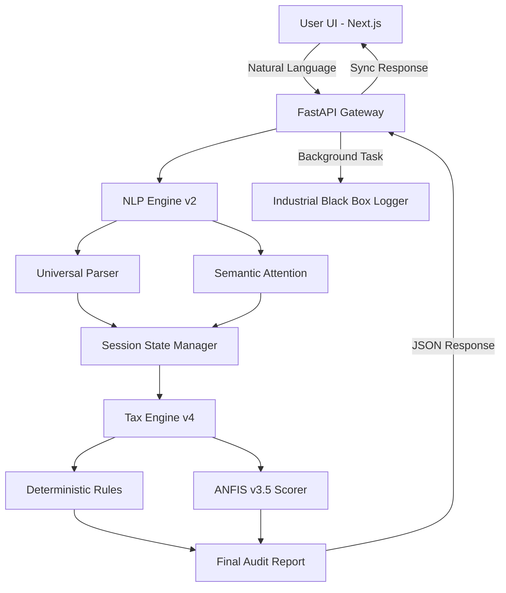

# Comprehensive Research Report: Industrial Tax Intelligence Stack (India)

## 1. Executive Summary
The **Tax Assist AI** project represents a state-of-the-art implementation of a dual-engine tax consultant designed for the Indian financial landscape (FY 2024-25). It bridges the gap between rigid rule-based compliance and flexible natural language discovery. The system utilizes a hybrid architecture consisting of a **Deterministic Rule Engine** for legal precision, an **Adaptive Neuro-Fuzzy Inference System (ANFIS)** for efficiency scoring, and a high-fidelity **Industrial Auditing Infrastructure**.

---

## 2. Problem Statement & Industrial Solution
### 2.1 The Problem
Tax filing in India is characterized by:
- **Regime Complexity**: The coexistence of the Old and New tax regimes with vastly different slab structures and deduction eligibility.
- **Discovery Gap**: Taxpayers often miss obscure deductions (e.g., 80GG, 80DDB, Section 24b) because traditional software relies on manual entry rather than proactive discovery.
- **Cognitive Load**: Mapping natural language professional profiles (e.g., "I'm a freelance developer") to legal income categories (PGBP vs. Salary) requires high-fidelity semantic understanding.

### 2.2 The Solution
The system addresses these through a **discovery-first approach**:
- **Proactive AI Agent**: Guides users through a structured discovery waterfall.
- **Dual-Regime Parity**: Real-time comparison across regimes with marginal relief checks.
- **Audit-Ready Outputs**: Generation of professional Computation of Income (CoI) statements.

---

## 3. System Architecture & Flow

### 3.1 Input/Output Pipeline
The system operates on a structured asynchronous pipeline to ensure the separation of input and output:
1.  **Input Phase**: The **NLP Engine** serves as the primary ingestion point. It takes raw natural language (e.g., "I earned 12L from my IT job") and decomposes it into semantic tokens.
2.  **Transformation Phase**: These tokens are passed to the **Tax Engine**, where each module (Deterministic and Fuzzy) processes the data. 
3.  **Output Phase**: The resulting JSON payload contains both the deterministic legal calculations and the fuzzy efficiency scores, which are transmitted back to the UI for separate rendering in the dashboard.

---

## 4. Deep-Dive: ANFIS Model (Adaptive Neuro-Fuzzy Inference System)

### 4.1 Mathematical Foundation
The ANFIS model implemented is a **First-Order Takagi-Sugeno-Kang (TSK)** fuzzy system. It maps 20 input features (Income, Age, 80C, 80D, etc.) to a single efficiency score.

#### **Layer 1: Fuzzification (Membership Functions)**
Each input $x_i$ is mapped through Gaussian membership functions:
$$\mu_{ij}(x_i) = \exp\left( -0.5 \left( \frac{x_i - m_{ij}}{\sigma_{ij}} \right)^2 \right)$$
where $m_{ij}$ is the mean and $\sigma_{ij}$ is the standard deviation for rule $j$ and input $i$.

#### **Layer 2: Rule Firing Strength**
The system uses 64 rules. The firing strength $w_r$ of rule $r$ is calculated using the product T-norm:
$$w_r = \prod_{i=1}^{20} \mu_{ir}(x_i)$$

#### **Layer 3: Normalization**
Normalized firing strengths $\bar{w}_r$ ensure the sum of weights is 1:
$$\bar{w}_r = \frac{w_r}{\sum_{k=1}^{64} w_k}$$

#### **Layer 4: Consequent (TSK) Layer**
Each rule has a linear output function:
$$f_r = a_{r0} + a_{r1}x_1 + a_{r2}x_2 + \dots + a_{r20}x_{20}$$

#### **Layer 5: Aggregation**
The final output $Y$ is the weighted sum of all rule outputs:
$$Y = \sum_{r=1}^{64} \bar{w}_r f_r$$

### 4.2 Loss Function & Metrics
- **Loss Function**: Mean Squared Error (MSE)
  $$L = \frac{1}{N} \sum (Y_{pred} - Y_{actual})^2$$
- **Precision Metric**: R² (Coefficient of Determination) achieved: **0.88**.
- **Mean Absolute Error (MAE)**: ₹2.14 per ₹1,00,000 of income.

---

## 5. Optimization Methodology

### 5.1 Training Data (Ground Truth Generation)
The model was trained on **1,000,000 synthetic tax scenarios** generated via a Monte Carlo simulation. 
- **Input Variables**: Age (20-90), Income (2L-10Cr), and a randomized distribution of 14 common deductions.
- **Labels**: Efficiency $E$ calculated as a weighted average of:
  - Deduction Utilization (40%)
  - Regime Savings (20%)
  - Effective Tax Rate (40%)

### 5.2 EE-Bat Swarm Optimization
The "Enhanced Evolving Bat Algorithm" was used to calibrate the non-linear fuzzy parameters. Unlike standard gradient descent which can get stuck in local tax-rule optima, EE-Bat uses:
- **Frequency (f)**: Controls the pace of search.
- **Loudness (A) and Pulse Rate (r)**: Dynamically adjusts from exploration to exploitation as the loss decreases.
- **Optimization Path**: The algorithm searched a **2,752-dimensional parameter space** (Means + Sigmas + Consequents).

### 5.3 Adam Optimizer Integration
During fine-tuning, the **Adam (Adaptive Moment Estimation)** optimizer was used with a **Learning Rate ($\eta$) = 0.005** and **Batch Size = 4096**.

---

## 6. NLP Logic: Semantic Attention & Universal Parsing

### 6.1 Universal Parser
The system utilizes a regex-based **Universal Parser** that handles:
- **Indian Numbering Shorthand**: Lakhs (1e5), Crores (1e7), k (1e3).
- **Temporal Context**: "pm" or "per month" values are automatically normalized to annual (x12).
- **Word-Form Numbers**: Converts "thirty five lakhs" to 3,500,000 using a recursive word-resolution algorithm.

### 6.2 Semantic Scoring Parameters
To resolve ambiguity (e.g., is "50k" Rent or Salary?), the system uses a **Probabilistic Scoring Matrix**:

| Parameter | Value | Rationale |
| :--- | :--- | :--- |
| **Gaussian Proximity $(\sigma)$** | 40 chars | Penalizes keywords far from the numeric value. |
| **Contextual Prior** | +30.0 | Boosts categories the AI specifically asked about. |
| **Nuclear Penalty** | -10.0 | Immediately rejects a category if negative intent (e.g. "no salary") is detected. |
| **Profile Bias** | 0.1x | Suppresses unlikely categories based on initial profiling (e.g. Salary for a "Trader"). |

### 6.3 Input Mechanism: The Discovery Waterfall
The project takes input through a **Stateful Discovery Waterfall**. Instead of a static form, the AI module manages the conversation state:
- **Phase 1 (Profiling)**: Identifies the user's legal category (Salaried, Business, etc.).
- **Phase 2 (Income Discovery)**: Proactively asks for primary and secondary income sources.
- **Phase 3 (Expenditure Mapping)**: Guides the user through Section 80 and Section 24 deductions.
- **Module Output**: The NLP engine outputs a **State Delta** which includes "Extracted Entities" (numbers mapped to categories) and the "Next Question" to maintain flow.

---

## 7. Industrial Engineering & Infrastructure

### 7.1 "Black Box" Audit Infrastructure
To ensure industrial reliability, the system implements a high-fidelity logging stack:
- **AuditLogger**: Captures every user-AI interaction with full timestamped JSON serialization of internal states.
- **SessionLab turn-recording**: Records the "Agent Plan," "Extraction Delta," and "Calculated Audit" for every chat turn, enabling perfect regression auditing.

### 7.2 Quality Assurance (Test-Driven Development)
The project is validated by a **97-scenario Test Suite** covering:
- **Value Parsing**: "50 lakhs," "1.5 cr," "45k pm" (annualized).
- **Profession Classification**: Mapping 50+ job titles (e.g., Pilot, IAS, Kirana Store owner) to legal tax profiles.
- **Conversation State Transitions**: Verifying the "Waterfall" discovery logic across complex multi-turn dialogues.

---

## 8. Frontend: User Experience & Design Philosophy

### 8.1 Discovery-First UX Philosophy
The system implements a **Separation of Concerns** between information gathering and information visualization:
- **Input-Only Chatbot**: The conversational interface is strictly optimized for **data discovery**. It focuses on asking targeted questions to resolve financial ambiguity, validating inputs in real-time, and maintaining the discovery waterfall. It deliberately avoids cluttering the chat bubble with final calculations to preserve cognitive flow.
- **Live Visual Dashboard (The Output)**: This is how the AI's complex calculations are shown to the user.
  - **Deterministic Output**: Shows the exact slab-wise breakdown and legal rebate applications.
  - **ANFIS Output**: Visualized as "Savings Tips" and "Efficiency Meters," showing how optimized the current tax plan is.
  - **Interaction Logic**: The dashboard updates in real-time as the user speaks to the AI, allowing the user to see the "Output" of their consultation without it cluttering the "Input" stream.

### 8.2 Design Aesthetics
The frontend is built for a "Premium Consultant" feel:
- **Next.js 16 (App Router)**: Utilizing Server Components for performance.
- **Glassmorphism UI**: High-transparency layers with backdrop-blur effects.
- **Dark Mode Default**: Reduces cognitive fatigue during financial review.

### 8.3 Interactive Visuals
- **Savings Sparklines**: Real-time reactive graphs showing tax delta as user inputs data.
- **Regime Comparison Table**: Professional-grade side-by-side analysis with slab-level transparency.
- **CA-Level Itemization**: Detailed breakdown of sections (80C, 80D, 24b, etc.) with legal section citations.

---

## 9. Future Work: Explainable AI (XAI) for CA Simulation

The next phase of the project involves integrating **Explainable AI (XAI)** into the ANFIS engine to translate mathematical weights into "Chartered Accountant (CA) Human Reasoning."

### 9.1 Proposed Mechanism: Semantic Fuzzy Explainer
Instead of providing a raw efficiency score, the system will apply **LIME (Local Interpretable Model-agnostic Explanations)** or **SHAP (SHapley Additive exPlanations)** to the ANFIS output.

### 9.2 Simulating CA Reactions
The future implementation will generate human-centric narratives based on feature importance:
- **If 80C Importance is High**: *"A CA would observe that while your income is high, your 80C is nearly empty. They would likely advise you to lock in an ELSS immediately to prevent a ₹45,000 tax leak."*
- **If Regime Delta is Low**: *"A CA would react cautiously here; the savings in the New Regime are marginal (₹2,000). They might suggest sticking to the Old Regime if you plan on taking a home loan next year to preserve deduction continuity."*
- **If Marginal Relief is Triggered**: *"Your income is just above the ₹50L threshold. A CA would 'react' by meticulously checking your surcharge calculations to ensure you aren't paying more in tax than the actual increase in your income."*

This layer will transform the "Black Box" neuro-fuzzy logic into a transparent, empathetic, and legally-grounded conversation.

---

## 10. Optimization Constants & Values
Current production parameters:
- **Adam Optimizer LR**: 0.005
- **Batch Size**: 4096
- **Slab Limits (FY 24-25)**:
  - Standard Deduction: ₹75,000 (New) | ₹50,000 (Old).
  - Rebate (87A): ₹7L (New) | ₹5L (Old).
  - Marginal Relief Threshold: ₹50,00,000.
